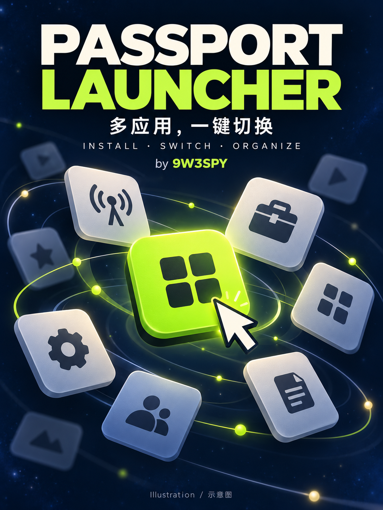

<a href="README.zh_CN.md">简体中文</a> · <strong>English</strong>

# Passport Launcher 0.4.1

[Download v0.4.1](https://github.com/lim3soft/passport_launcher/releases/tag/v0.4.1) · [AI-Passport community](https://ai-passport.folotoy.cn/plays/1704/) · [UI previews](assets/community/0.4.1/)

**First installation:** download `Passport-Launcher-0.4.1-fresh.bin` from Releases and flash at **0x0**. It intentionally clears existing apps and settings. **Already on 0.4.0:** use the smaller update BIN with whole-chip erase off, following the steps below. The cover is an illustration; UI captures are host renders.

Multi-firmware launcher for the verified FoloToy AI-Passport ESP32-C3 / 8 MiB board, developed by **9W3SPY**. QSO Vision remains a separate application; it is not built into this firmware. Original AI-Passport and QSO Vision source checkouts are preserved.

This version removes the community downloader and replaces the three fixed 2 MiB positions with variable allocations from shared flash. Upload a local **`.bin`** through the portal, then select the installed app on the device. The portal accepts no proprietary application-file format. Internet access is not needed to switch installed apps.

There is **6.375 MiB of shared app storage**, with **128 KiB of private settings storage reserved for each installed app** and flash alignment overhead. A ROM is allocated its actual size rounded to erase sectors, with a 64 KiB aligned start. The portal and device show remaining space; the portal also reports the largest new ROM that currently fits after its settings reservation. There is no 2 MiB per-app ceiling. App count depends on actual image sizes and settings, subject to the 16-entry app index. Storage is finite; incompatible chip/SDK/custom-partition images are still refused.

## Updating from 0.4.0

Use **Passport-Launcher-0.4.1-update.bin at 0x0**, with **whole-chip erase disabled**. First power-cycle, cancel Auto start and wait for the launcher menu so it captures the last community app's default-NVS settings. The update ends before shared app storage; the partition table, SDK 2 registry and private-data layout are unchanged. Installed apps and their saved snapshots remain outside the image. The short merged prefix does reset platform/default NVS, so returning to the menu first matters.

Version 0.4.1 makes Passport Launcher a larger, bold main-menu heading and separates installed apps from launcher actions with a line. Developer credit is inside About. Auto start defaults to Last booted app, or can pin a specific installed app while retaining its independent On/Off toggle and cancellable five-second countdown. The portal shows real upload progress, waits for device verification, reports confirmed completion/errors, removes the QSO legacy-import advice paragraph, and adds the developer GitHub link in About and the credited footer.

A fresh migration from the old 0.1–0.3 fixed-slot layout still requires a deliberate full refresh, clearing installed apps/settings. The build also produces a separate `build/PassportOS-fresh.bin` padded to 8 MiB. That file is not the normal 0.4.0 update. No device has been flashed from this host.

After flashing, choose **Install a ROM**. Connect to Wi-Fi **Passport Launcher**, password **aipassport**, and visit **http://192.168.168.1**. Choose a local `.bin`, wait for validation, then press **Install / update**. Hold OK on the device to return to the library and choose the app. Standard merged BINs are checked and their app payload is extracted; their bootloaders and partition tables are not installed.

The menu retains full-row rounded selection, scrolling long titles, Manage apps with a Cancel-first warning that uninstall erases all saved data, Auto start On/Off with the highlighted chosen startup app and a cancellable five-second timer, and About on device and portal. About includes the version, ESP-IDF 5.5.3, MIT/open-source notices and **Inspired by M5 Launcher**. Full license texts remain available offline at `/licenses.txt`.

## Compatibility and storage

QSO Vision and Internet Radio pass the supplied BIN import and production-manager host models. Their ESP32 machine code has not been executed here. Pokémon and app 1434 can fit by code size in an empty shared pool, but their additional resource/data partitions still require a source port. Removing a size restriction does not provide those partitions.

Ordinary community ESP-IDF 5.5.x apps receive independent 16 KiB default-NVS snapshots inside their private storage. Native apps must use the **SDK 2** in this checkout and reserve 32 bytes of custom RTC memory; older SDK 1 app builds must be rebuilt or replaced with their original community BIN. Native apps keep stable-ID private NVS access and health acknowledgement. No QSO app is bundled.

Updates preserve private data and may relocate the selected app's code without moving another app. Interrupted installs remain non-bootable and retryable. Fragmentation can prevent a ROM fitting despite a larger total free-byte count; use the displayed largest-ROM value. Uninstalling an app releases its code and data after erasure. See [shared storage and recovery](docs/shared-storage.md) and [the interface guide](docs/interface.md).

All app resets return to the launcher; optional cold-start auto start remains cancellable. The bootloader reconstructs the appropriate partition table before reading it, recovering interrupted table writes. Switching to an app and back can each erase the table sector once; this adds flash wear and has not been endurance-tested. Protection and data isolation require cooperating firmware, not a hardware sandbox. Integrity hashes do not authenticate publishers.

## Validation and development

Activate ESP-IDF **5.5.3**, then run `bash tools/validate.sh`. This performs host checks, builds from isolated `sdkconfig.defaults`, creates and verifies the merged update image and a separate full fresh-install image, and retains a matching ELF/MAP archive in `build/firmware/<sha256>/`. Host checks need C, Python 3, Node.js and OpenSSL development libraries. `bash tools/render_ui_preview.sh` exercises the real pinned LVGL renderer with a 48 KiB pool; previews are host renders, not device screenshots.

Build, host tests and device acceptance are reported separately in [validation results](docs/validation-results.json). Physical RF/heap/stack, application execution, visual timing, flash endurance and electrical power-cut recovery still need owner-device testing. Historical fixed-slot architecture and SDK 1 delivery archives are retained for reference, not current installation instructions.

The [hardware audit](docs/research.md) records source evidence and unknown board measurements. See the retained [MIT license](LICENSE) and [third-party notices](docs/third-party.md). M5 Launcher is design inspiration; no upstream Launcher source was copied.
