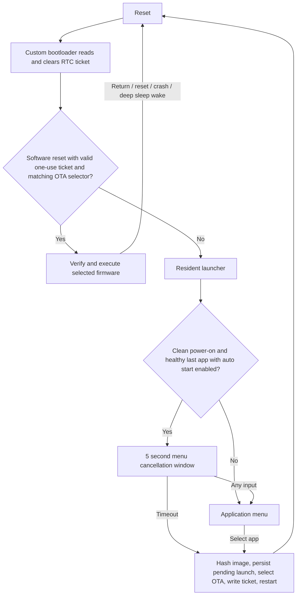

<a href="research.zh_CN.md">简体中文</a> · <strong>English</strong>

# Hardware evidence and architecture decision

> Historical architecture: the fixed-slot decision below describes 0.1–0.3. The hardware evidence remains relevant; 0.4.0 uses [shared storage](shared-storage.md).

Audit date: 2026-10-27. Facts below distinguish local product/BSP evidence from silicon capabilities and measurements still required. This is an architectural OS-like launcher, not concurrent processes or a privileged firmware sandbox.

## Local evidence

Read-only sources inspected:

- `/root/ai-passport`: base commit `006c2279852e352a8433b2c21e5e09be2ca36f77`, branch `feature/brandmeister-monitor`, with extensive existing modifications. They were preserved.
- `/root/qso-ai-passport-publish`: clean `main` at `b4ecee1295dd5ad9d8b1c95e1b5f6f91e5cbd4a2`; used as the isolated QSO port source.
- Product specifications, hardware guide, `components/bsp/include/bsp_pins.h`, BSP implementations, partition CSV, sdkconfig/defaults, build JSON, and release archive manifests. Root incremental build outputs were not assumed to represent the final QSO release.

| Item | Established evidence | Remaining verification |
| --- | --- | --- |
| MCU | ESP32-C3, single-core RISC-V family; build target `esp32c3` | Exact orderable part/module, board revision and silicon revision require marking/ROM/eFuse read. Minimum supported build revision 0.3 is not a measured device revision. |
| Flash | Product specifies 8 MiB; image/build uses DIO, 80 MHz, 8 MiB header | JEDEC ID, actual attached part/capacity and reliable board timing require a device. |
| RAM | No PSRAM per product. C3 silicon has 400 KiB SRAM including 16 KiB cache, plus 8 KiB RTC SRAM | Usable heap is lower; upload/QSO peak heap and largest DMA block require runtime measurement. |
| Display | ST7789P3, 240×320 portrait, RGB565, four-line SPI2, 80 MHz mode 0 | Actual rendering and electrical timing |
| Inputs | UP/DOWN/OK share GPIO0 ADC1_CH0; dedicated hardware power button is separate | Threshold distributions across boards/battery levels |
| USB | Type-C 5 V input; configured native USB Serial/JTAG on GPIO18/19 | Cable, host enumeration, board recovery access and eFuse state |
| Wireless | Product: 2.4 GHz 802.11 b/g/n and Bluetooth 5 LE; classic Bluetooth unsupported | SoftAP/radio coexistence on the physical board; launcher leaves BLE disabled |
| Boot | ROM then ESP-IDF second stage at `0x0`; table `0x8000`; existing app at `0x10000` | Physical reset/recovery behavior |
| Existing table | `nvs` `0x9000/0x6000`; `phy_init` `0xf000/0x1000`; `factory` `0x10000/0x7f0000`; no OTA data/slots | Current connected device may have another table |
| Toolchain | ESP-IDF 5.5.3, CMake/Ninja, esptool 4.12.0, RISC-V GCC 14.2.0; LVGL 9.6.0~1 in lock | Tool versions do not prove device revision |
| Persistence | QSO settings and saved Wi-Fi profiles use the `monitor` namespace through default `nvs_open`; confirmed Wi-Fi profiles are app-managed with SDK `WIFI_STORAGE_RAM`; QSO history is an in-memory store | Legacy settings export/import must be verified before migration |
| Security | Existing build disables rollback, secure boot and flash encryption | Device fuses were not read; no fuse programming is performed |

Silicon memory/radio/USB properties above come from [Espressif's C3 datasheet](https://www.espressif.com/sites/default/files/documentation/esp32-c3_datasheet_en.pdf). Fixed USB Serial/JTAG is not a general USB OTG controller: native mass-storage, HID or USB-host installation must not be promised. A phone browser over Wi-Fi is the implemented transfer path. No SD slot is assumed or added.

### Driver reuse and initialization

The BSP is copied with its license. LCD: MOSI9, SCLK8, CS1, DC20, no wired MCU reset, inversion required, vendor register sequence retained; backlight21 uses LEDC 5 kHz/10 bit. GPIO21 cannot also be UART0 TX. LVGL RGB565 byte swap and rounded flush mask are retained. The inspected implementation uses **40 lines**, not the guide's older 20-line buffer description: `240×40×2 = 19,200` bytes. LVGL is locked outside its task.

Buttons retain ADC calibration, external 10 kΩ pull-up, voltage windows `[0,150)`, `[150,447)`, `[447,1900)` mV, 180 ms short/500 ms long timing and nonblocking event dispatch. A single ADC cannot reliably decode arbitrary simultaneous button chords. The guide calls GPIO0 boot-related; C3's datasheet instead identifies GPIO2/8/9 as strapping pins. **No GPIO0 ROM-download recovery recipe is inferred.** Recovery wiring must be established on the actual board.

I2C SDA10/SCL7 is shared by ES8311 (`0x18`) and CW2017 (`0x63`). I2S MCLK6/BCLK5/WS3/DOUT2/DIN4 and the always-on amplifier assumptions remain unchanged. Launcher needs display, buttons and optional battery only; QSO retains its audio initialization. Audio and networking are not started in button callbacks. LCD/codec shutdown levels and reset behavior still require physical acceptance.

### Measured files, not measured hardware

QSO Vision 2.3.3 merged release: **1,894,144 bytes**, SHA-256 `8f9a2198fd5d764945cd96931fb7b1e81d4c7ee986e1b6e99f44079e9005a483`. Its matching archive records an **1,828,608-byte app payload** (about 1.744 MiB), app SHA-256 `6ab6aec30d4453a663f5de40419de9764c9c3586cae0bced8f58881612563228`, and matching ELF identity. Thus a 2 MiB slot has **268,544 bytes** of headroom before SDK changes. The older root incremental app file is a different size and was not used for this decision. Actual new build sizes/hashes are recorded in `build/firmware/*/manifest.json` and the validation report.

## Compare architectures

Assume the selected budget: 64 KiB boot/table/system area, 1.5 MiB launcher, 448 KiB metadata/private data; **6 MiB remains for app binaries/repository**. Counts below use 2 MiB uncompressed images; package metadata also needs space. Smaller images can improve a different layout, but cannot add a fourth slot to this fixed table.

| Criterion | A: dedicated OTA slots | B: repository + one 2 MiB execution slot | C: repository + two 2 MiB execution slots |
| --- | --- | --- | --- |
| Image capacity in remaining 6 MiB | Three independent 2 MiB apps | At most two near-2 MiB repository images; the selected app is duplicated in execution, with metadata reducing the boundary | Less than 2 MiB remains for repository; insufficient for an additional full-size retained image plus metadata |
| Switching | Image verification, OTA selection, reboot; no code copying | Verify and rewrite up to 2 MiB on each cache miss | Switch cached slot quickly; otherwise install into inactive slot |
| Flash wear | Mainly installations/updates plus small selection writes | Full-slot erase/program on repeated switching | Lower than B if cache hits, higher than A on misses |
| Data | Stable private partitions, no runtime swapping | Stable private partitions still required | Same requirement |
| Reliability | Resident launcher survives interrupted app write; updated app may need reinstall | Launcher recovers interrupted copy; repository itself needs transactional updates/GC | Can preserve an old executable during a swap, but repository durability needs additional staging |
| Compatibility | Cooperative IDF/ABI contract | Same contract; copying does not isolate data or fix absolute flash assumptions | Same contract, more metadata states |
| Isolation/security | Software cooperation, no arbitrary-firmware sandbox | No improvement from a repository | No improvement from extra slots |
| Maintenance | Fixed map, standard SDK OTA APIs, simple ownership | Package allocator, GC, streaming copy and restore journal | Most complex allocator/cache/recovery policy |

**Decision: A for 0.1, plus a resident factory recovery launcher.** The resident launcher is sometimes called a hybrid feature, but this implementation has **no internal firmware repository** and is classified as A to keep that distinction explicit. An executable app partition itself retains its image for future launches. The phone can retain additional packages for reinstalling; installed apps switch without the phone. Four near-QSO-size images cannot fit with these reservations. Apps needing more than 2 MiB or more bulk data require a deliberate alternative layout with fewer apps, smaller assets, or verified larger-flash hardware. No hardware replacement is assumed available.

No switching latency is presented as measured. A streams a SHA check before reboot; B/C additionally depend on measured erase/program throughput. A safe two-copy update of every installed app would require more flash than this map supplies. Update failure preserves the launcher and other apps, **not the previous version of the updated app**.

### Selected fixed map

| Partition | Offset | Size | Owner |
| --- | ---: | ---: | --- |
| `nvs` | `0x9000` | 16 KiB | Platform SDK/calibration only |
| `otadata` | `0xd000` | 8 KiB | Standard OTA selector, two sectors |
| `phy_init` | `0xf000` | 4 KiB | Platform |
| `factory` | `0x10000` | 1.5 MiB | Resident PassportOS |
| `app0` | `0x190000` | 2 MiB | OTA 0 |
| `app1` | `0x390000` | 2 MiB | OTA 1 |
| `app2` | `0x590000` | 2 MiB | OTA 2 |
| `pos_meta` | `0x790000` | 64 KiB | Registry and startup state |
| `appdata0` | `0x7a0000` | 128 KiB | Stable ID assigned to slot 0 |
| `appdata1` | `0x7c0000` | 128 KiB | Stable ID assigned to slot 1 |
| `appdata2` | `0x7e0000` | 128 KiB | Stable ID assigned to slot 2 |

The final byte is `0x7fffff`; app offsets are 64 KiB aligned, data offsets sector aligned, with no overlap. There is no spare bulk filesystem. The old 24 KiB `nvs` overlaps the proposed OTA data sectors: **the first migration cannot preserve settings by flashing this table over a live device without an export/import plan**.

## Reference launcher review

Reviewed through GitHub/raw source, as retrieved on the audit date; remote Git clone failed even after network approval. These web snapshots are **not pinned to a verified upstream commit**. Follow file links to reassess changes before reuse. No code was copied from Launcher.

| Code path | Observed mechanism | PassportOS adaptation |
| --- | --- | --- |
| [main.cpp](https://github.com/bmorcelli/Launcher/blob/main/src/main.cpp) | Boot screen, input escape, configurable installed-app launch; distinct setup/menu stages | New LVGL menu and cancel window; one-use boot ticket avoids relying on the ADC ladder in a bootloader |
| [app_registry.cpp](https://github.com/bmorcelli/Launcher/blob/main/src/app_registry.cpp) | `l_apps` NVS metadata keyed to partition labels; scans OTA entries; launch sets OTA boot and handles BLE bonds | Full stable IDs in a versioned blob; explicit READY states; SDK-resolved private NVS; BLE omitted |
| [install_shared.cpp](https://github.com/bmorcelli/Launcher/blob/main/src/install_shared.cpp) | Shared naming/metadata helpers, partition associations and BLE bond handoff after installation | One package contract and one streamed installation path; stable ID independent of file path/name/version |
| [partition_install_layout.cpp](https://github.com/bmorcelli/Launcher/blob/main/src/partition_install_layout.cpp) | Evaluates reuse/free-space/repartition/removal choices and accompanying filesystem partitions | Fixed allowlisted targets; reject oversize rather than resize/remove another app's data |
| [partitioner.cpp](https://github.com/bmorcelli/Launcher/blob/main/src/partitioner.cpp) | Partition manager supports creation, compaction, table changes, formatting and associated-data deletion | No on-device repartitioning or global NVS reset |
| [partition_table_model.cpp](https://github.com/bmorcelli/Launcher/blob/main/src/partition_table_model.cpp) | Parses/builds/validates tables, MD5, moves data, writes/verifies table and OTA selector sectors | Reuse the design need for bounds/integrity checks; use IDF's installed fixed table and OTA API, never rewrite the table at runtime |
| [backup_manager.cpp](https://github.com/bmorcelli/Launcher/blob/main/src/backup_manager.cpp) | SD-backed partition backup catalog `/bkp/backupData.json`; file-path-derived app numbers | Cannot use SD workflow; keep data in place; do not derive identity from filename or use a short hash as identity |
| [webInterface.cpp](https://github.com/bmorcelli/Launcher/blob/main/src/webInterface.cpp) | Authenticated routes, streamed multipart uploads, shared install planning and browser management | On-demand local AP, session token, raw streamed package; no bundled bootloader/table writes |
| [nvs_helpers.cpp](https://github.com/bmorcelli/Launcher/blob/main/src/nvs_helpers.cpp) | Scoped handles, explicit commit/error handling and namespace utilities | Named private partitions, checked commits and no erase-on-init-error fallback |

The upstream [LICENSE](https://github.com/bmorcelli/Launcher/blob/main/LICENSE) states MIT, copyright 2023 shikarunochi. Any future copied portions must carry its copyright and license notice; dependency and per-file notices must also be checked. Current implementation reuses FoloToy code with its own retained MIT notice, not Launcher code.

## Boot and recovery design

The [IDF OTA guide](https://docs.espressif.com/projects/esp-idf/en/v5.5.3/esp32c3/api-reference/system/ota.html) documents boot selection and redundant OTA metadata. The [bootloader guide](https://docs.espressif.com/projects/esp-idf/en/v5.5.3/esp32c3/api-guides/bootloader.html) describes table-driven selection and compatibility limits. Local IDF 5.5.3 `bootloader_start.c`, `bootloader_utility.c`, `esp_ota_ops.c`, RTC reservation Kconfig, and `rtc_custom_section` test were inspected for this implementation.

Ticket storage uses ESP-IDF's reserved custom RTC area, not guessed RTC registers or GPIOs. All apps must reserve the identical ABI. Reset without a ticket cannot intentionally resume the selected OTA image. Native rollback is disabled: it can choose a different OTA app, whereas our policy returns to the launcher. App health acknowledgement controls future auto start; it is not an image signature or a rollback copy. Corrupt launcher/partition table or disabled ROM USB access still requires verified hardware recovery; the design does not promise immunity to arbitrary flash corruption.
